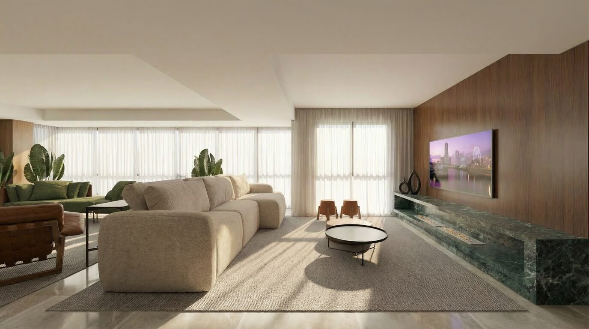
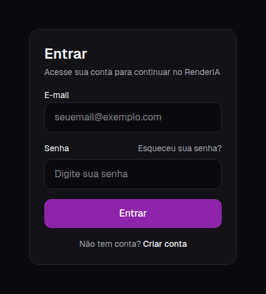
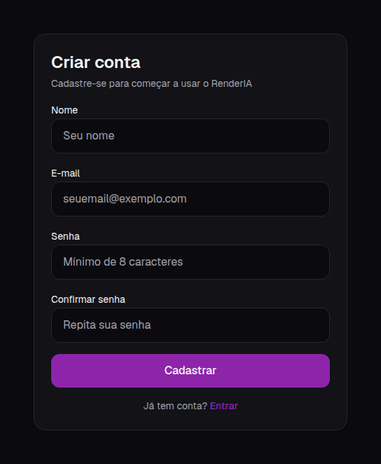
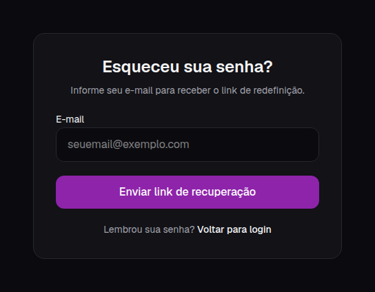
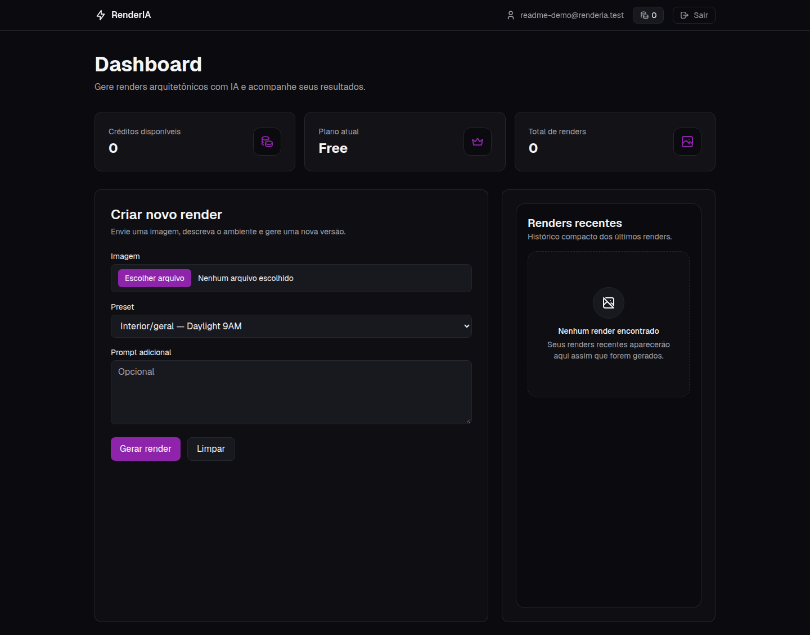
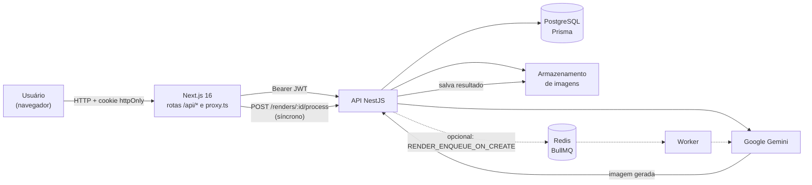
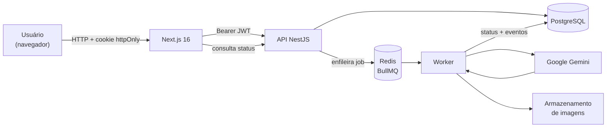

<div align="center">

# RenderIA

**Renderização arquitetônica com inteligência artificial.**

Plataforma Full Stack que transforma imagens de projetos arquitetônicos em visualizações realistas,
com integração a IA generativa, processamento assíncrono e gerenciamento de créditos.

<br />


[Frontend](https://github.com/Rzirbes/render-ia) · [API (backend)](https://github.com/Rzirbes/renderia-api)

<br />



<sub>Render real gerado pela aplicação.</sub>

</div>

---

## Destaques

| | |
| --- | --- |
| 🏛️ **Validado com arquitetos** | Testado por **4 arquitetos** durante a fase de desenvolvimento e validação ([detalhes](#validação-com-profissionais-de-arquitetura)) |
| 🧱 **Full Stack de ponta a ponta** | Frontend Next.js 16 + API NestJS 11, ambos desenvolvidos por mim ([minha contribuição](#minha-contribuição)) |
| 🤖 **IA generativa aplicada** | Integração com Google Gemini e presets de prompt que preservam câmera, geometria e mobiliário |
| 🔐 **Sessão segura** | JWT em cookie `httpOnly`, com o Next.js atuando como BFF entre navegador e API |
| 💳 **Créditos transacionais** | Débito atômico junto à mudança de status do render, com histórico de movimentações |
| ⚙️ **Fila e rastreabilidade** | BullMQ + Redis, worker com retentativas e trilha de eventos por render |
| ✅ **Testes na API** | 121 testes unitários com Jest, todos passando |

---

## Sumário

- [Destaques](#destaques)
- [Sobre o projeto](#sobre-o-projeto)
- [Validação com profissionais de arquitetura](#validação-com-profissionais-de-arquitetura)
- [Demonstração da aplicação](#demonstração-da-aplicação)
- [Funcionalidades](#funcionalidades)
- [Tecnologias](#tecnologias)
- [Arquitetura do sistema](#arquitetura-do-sistema)
- [Desafios de engenharia](#desafios-de-engenharia)
- [Minha contribuição](#minha-contribuição)
- [Executando localmente](#executando-localmente)
- [Qualidade e testes](#qualidade-e-testes)
- [Estado do projeto](#estado-do-projeto)
- [Autor](#autor)

---

## Sobre o projeto

O **RenderIA** permite que um profissional envie a imagem de um projeto (por exemplo, uma captura de tela de um modelo 3D) e receba uma versão fotorrealista gerada por IA, preservando câmera, geometria e layout do ambiente original.

O usuário escolhe um **preset de iluminação**, pode complementar com um **prompt adicional** e acompanha o andamento de cada solicitação no histórico. Cada geração consome créditos da conta, e renders concluídos podem ser **editados** para gerar novas versões a partir do resultado anterior.

Este repositório contém o **frontend** (Next.js). A API, o worker de processamento e a integração com a IA ficam no repositório [`renderia-api`](https://github.com/Rzirbes/renderia-api).

---

## Validação com profissionais de arquitetura

O RenderIA foi **testado por 4 arquitetos** durante sua fase de desenvolvimento e validação.

Os testes de uso com profissionais da área aproximaram o desenvolvimento das necessidades reais do público-alvo: em vez de validar o produto apenas do ponto de vista técnico, a aplicação foi colocada nas mãos de quem trabalha diariamente com projetos e visualização arquitetônica.

> Esses testes foram sessões de uso exploratório com profissionais, e não uma pesquisa formal. Eles são distintos dos testes automatizados descritos em [Qualidade e testes](#qualidade-e-testes).

---

## Demonstração da aplicação

### Autenticação

| Login | Cadastro | Recuperação de senha |
| :---: | :---: | :---: |
|  |  |  |

### Dashboard e criação de render



O formulário de criação reúne upload da imagem, seleção do preset de iluminação e prompt opcional. Os presets disponíveis são:

| Preset | Uso |
| --- | --- |
| Interior/geral — Daylight 9AM | Luz natural neutra da manhã, sombras suaves |
| Interior/geral — Blue Hour | Crepúsculo azul no exterior com luz interna quente (3000K) |
| Exterior — Daylight Locked | Cenas externas com luz diurna e composição preservada |

> Capturas feitas em ambiente local com uma conta de teste, sem dados de usuários reais.
> O card "Plano atual" exibe um valor fixo de interface; não existe sistema de planos.
> As telas de processamento, histórico preenchido, visualização/download e edição ainda serão adicionadas (ver [Estado do projeto](#estado-do-projeto)).

### Resultados gerados pela aplicação

Renders reais produzidos pelo RenderIA para um mesmo ambiente interno, mostrando variações de iluminação e acabamento sobre a mesma composição. A imagem no topo deste README pertence à mesma série.

| | |
| :---: | :---: |
|  |  |

> As imagens de entrada correspondentes a esses resultados ainda não foram incluídas; a comparação **antes e depois** será adicionada quando os pares estiverem disponíveis.

---

## Funcionalidades

### Autenticação

- Cadastro e login com e-mail e senha
- Sessão autenticada com JWT armazenado em **cookie `httpOnly`** pelo servidor Next.js
- Proteção de rotas (`/dashboard`, `/home`) e redirecionamento de usuários autenticados nas telas públicas
- Recuperação e redefinição de senha com envio de e-mail (Resend)
- Logout

### Renderização

- Upload de imagem com limite de 20 MB e **compressão automática no navegador** para arquivos grandes ou PNG
- Três **presets de iluminação** e prompt adicional opcional
- Geração de renders com **Google Gemini** (modelo de imagem configurado por preset no backend)
- **Edição de renders existentes**: um novo render é criado a partir do resultado anterior, mantendo o vínculo com o render de origem
- Histórico paginado, visualização em modal e **download** da imagem gerada

### Processamento

- Fila **BullMQ** sobre **Redis** com worker dedicado, tentativas automáticas e backoff exponencial (implementada, mas ainda não é o caminho padrão; ver [Arquitetura](#arquitetura-do-sistema))
- Estados de solicitação: `PENDING` → `PROCESSING` → `DONE` / `ERROR`
- **Rastreamento de eventos** por render (`CREATED`, `PROCESSING_STARTED`, `COMPLETED`, `FAILED`, `QUEUE_ENQUEUE_FAILED`, `REQUEUED`)
- Campos de rastreabilidade: `traceId`, `clientRequestId`, códigos e mensagens de erro
- Reenfileiramento de renders pendentes há muito tempo (endpoint administrativo, com autenticação ainda provisória)

### Créditos

- Consulta de saldo (exibido no cabeçalho e no dashboard)
- Histórico de transações de crédito (endpoint `GET /credits/me/txs` na API; ainda sem tela no frontend)
- Débito automático e atômico no início do processamento de cada render
- Concessão de créditos apenas pelo servidor (endpoint administrativo)

> Compra de créditos, planos pagos e pagamentos **não** estão implementados.

---

## Tecnologias

| Camada | Tecnologias | Responsabilidade |
| --- | --- | --- |
| **Frontend** |        | Interface, validação de formulários, cache e revalidação de dados, gerenciamento de sessão e intermediação das chamadas à API |
| **Backend** |       | Regras de negócio, autenticação, persistência, créditos, fila e worker de processamento |
| **Integrações** |   | Geração de imagens com IA e envio de e-mails transacionais (recuperação de senha) |

---

## Arquitetura do sistema

O navegador nunca recebe o token JWT. O **Next.js atua como intermediário (BFF)**: as rotas em `src/app/api/*` recebem as requisições do cliente, leem o token do cookie `httpOnly` e repassam a chamada à API NestJS com o cabeçalho `Authorization`.

### Arquitetura atual



### Arquitetura planejada



> **Transparência sobre o estado atual:** a fila BullMQ e o worker já existem, mas a migração para processamento **exclusivamente assíncrono** ainda não foi concluída. Hoje o frontend dispara o processamento via `POST /renders/:id/process`, que aguarda a resposta da IA. O enfileiramento na criação está atrás da flag `RENDER_ENQUEUE_ON_CREATE` (desligada por padrão) para evitar processamento duplicado. Uma transição atômica `PENDING → PROCESSING` garante que a IA seja chamada e os créditos debitados uma única vez, mesmo que as duas vias coexistam.

### Estrutura do frontend

```
src/
├── app/
│   ├── [locale]/          # páginas (login, register, dashboard, forgot/reset-password)
│   └── api/               # rotas BFF: auth e renders → API NestJS
├── features/
│   ├── auth/              # formulários, schemas Zod, sessão, serviços
│   ├── render/            # formulários, histórico, modal, hooks SWR, serviços
│   ├── dashboard/         # cards de estatísticas
│   └── layout/            # cabeçalho
├── components/ui/         # componentes base
├── lib/api.ts             # fetch autenticado do lado do servidor
└── proxy.ts               # locale e proteção de rotas
```

---

## Desafios de engenharia

| Desafio | Solução implementada |
| --- | --- |
| **Integração com IA generativa** | Modelos de imagem tendem a "reinventar" a cena. Os presets combinam regras estritas (preservar câmera, geometria e mobiliário; proibir objetos novos) com parâmetros de iluminação e materiais. |
| **Tarefas demoradas** | Fila BullMQ com worker, retentativas e backoff exponencial. A migração completa para o fluxo assíncrono **ainda está em andamento** (ver [Arquitetura](#arquitetura-do-sistema)). |
| **Gerenciamento de créditos** | Débito dentro de uma transação do banco, junto com a mudança de status: só debita quem "reivindica" o render `PENDING`, e saldo insuficiente desfaz toda a operação. Cada movimentação gera um `CreditTransaction`. |
| **Autenticação e autorização** | JWT em cookie `httpOnly`, inacessível ao JavaScript do navegador, repassado pelo Next.js à API. Consultas de render são filtradas pelo usuário autenticado. A verificação de propriedade dos uploads **ainda está prevista**. |
| **Armazenamento de imagens** | Arquivos gravados em disco com nomes gerados pelo servidor; caminhos validados por formato e resolvidos no sistema de arquivos para impedir acesso fora do diretório permitido. |
| **Histórico de renderizações** | Cada edição cria um novo render vinculado ao anterior (`parentRenderId`), preservando as versões. No frontend, SWR revalida o histórico após cada geração. |
| **Falhas e rastreabilidade** | Linha do tempo de eventos por render (`RenderEvent`), `traceId`, códigos e mensagens de erro para investigar falhas de enfileiramento ou da IA. |

---

## Minha contribuição

Desenvolvi o RenderIA de ponta a ponta: sou o único autor dos commits nos dois repositórios ([frontend](https://github.com/Rzirbes/render-ia) e [API](https://github.com/Rzirbes/renderia-api)), entre fevereiro e novembro de 2026.

**Frontend (Next.js)**
- Arquitetura organizada por features (`auth`, `render`, `dashboard`, `layout`)
- Camada BFF com route handlers do Next.js e sessão em cookie `httpOnly`
- Proteção de rotas e roteamento por locale em `proxy.ts`
- Formulários com React Hook Form + Zod, cache e revalidação com SWR
- Fluxo de upload com compressão no navegador, geração, edição, histórico, modal de visualização e download

**Backend (NestJS)**
- Modelagem de dados com Prisma e PostgreSQL (`User`, `Render`, `RenderEvent`, `CreditTransaction`)
- Módulos de autenticação (JWT, hash de senha com Argon2, recuperação de senha), usuários, créditos, renders, e-mail e administração
- Integração com Google Gemini e engenharia dos prompts dos presets de iluminação
- Fila BullMQ com worker, trilha de eventos e reenfileiramento de renders pendentes
- Documentação da API com Swagger (`/docs`) e infraestrutura local com Docker Compose

**Qualidade e segurança**
- 14 suítes de testes unitários (121 testes) e suítes e2e na API
- Validação das variáveis de ambiente na inicialização
- Primeira fase de correções de segurança: validação de caminhos de arquivo, prevenção de processamento e débito duplicados, e remoção de endpoints de autoatribuição de créditos

---

## Executando localmente

### Pré-requisitos

- Node.js 20+
- [pnpm](https://pnpm.io/)
- A API [`renderia-api`](https://github.com/Rzirbes/renderia-api) em execução (com PostgreSQL e Redis; o repositório da API inclui um `docker-compose.yml`)

> O frontend **depende da API backend**: sem ela, login, cadastro e geração de renders não funcionam.

### Instalação

```bash
git clone https://github.com/Rzirbes/render-ia.git
```

```bash
cd render-ia
```

```bash
pnpm install
```

### Variáveis de ambiente

Crie o arquivo `.env.local` na raiz do projeto:

```env
# URL da API NestJS (renderia-api)
NEXT_PUBLIC_API_URL=http://localhost:3000
```

`NEXT_PUBLIC_API_URL` é a única variável lida pelo frontend. Nenhuma chave de IA ou segredo fica no frontend.

### Inicialização

A API usa a porta `3000` e, em desenvolvimento, libera CORS para `http://localhost:3001`. Por isso, rode o frontend na porta 3001:

```bash
pnpm dev -p 3001
```

Acesse **http://localhost:3001**. A raiz redireciona para `/pt/login` (ou para o dashboard, se houver sessão ativa).

> Contas novas começam com o saldo definido por `SIGNUP_BONUS_CREDITS` na API (padrão `0`). Para gerar renders localmente é preciso conceder créditos pelo endpoint administrativo da API.

---

## Qualidade e testes

| Tipo | Onde | Situação |
| --- | --- | --- |
| Testes unitários | API (`renderia-api`) | **14 suítes / 121 testes** com Jest, passando (`pnpm test`): auth, users, credits, renders, processador, storage, validação de ambiente e uma regra que impede `console.log` no código |
| Testes e2e | API (`renderia-api/test`) | Suítes de auth, users, credits e renders com Supertest (`pnpm test:e2e`); exigem banco e Redis locais |
| Testes automatizados | Frontend (este repositório) | **Ainda não implementados.** A verificação atual é feita via ESLint e TypeScript |
| Testes de uso | Produto | Realizados por **4 arquitetos** durante a fase de validação (ver [seção dedicada](#validação-com-profissionais-de-arquitetura)) |

---

## Estado do projeto

> 🚧 **MVP em evolução**

O RenderIA é um MVP funcional que está passando por melhorias de **segurança, processamento, persistência e experiência do usuário**. Ainda não deve ser considerado pronto para produção.

**Já implementado**
- Fluxo completo de autenticação, incluindo recuperação de senha
- Upload, geração, edição, histórico e download de renders
- Créditos com débito transacional e histórico de movimentações
- Fila BullMQ, worker e trilha de eventos por render
- Primeira fase de correções de segurança na API (validação de caminhos de arquivo, prevenção de processamento duplicado, remoção de endpoints de autoatribuição de créditos)

**Em andamento / próximos passos**
- Processamento exclusivamente assíncrono via BullMQ, com acompanhamento de status no frontend
- Vínculo e verificação de propriedade dos uploads por usuário
- Autenticação administrativa definitiva (hoje provisória, por chave)
- Armazenamento de imagens em serviço externo e persistência de longo prazo
- Testes automatizados no frontend
- Capturas das telas de processamento, histórico, visualização/download, edição e comparativos antes/depois

---

## Autor

**Romulo Zirbes** — Desenvolvedor Full Stack

[](https://github.com/Rzirbes)
